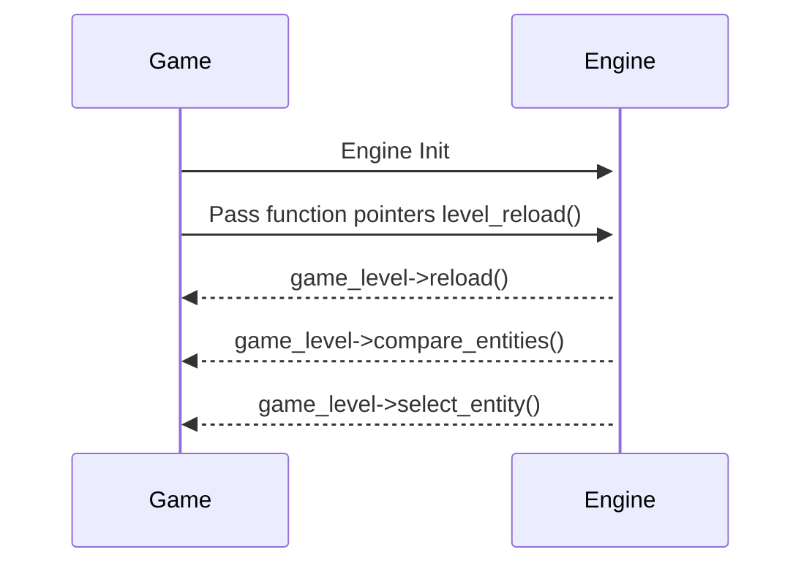

After some time of working on this project. I have come to encounter a problem time and time again and needed some creative way to fix it, i.e invoking game code from platform code.

I have been attempting to create a library and game engine that a game can import and use and create games easily. But there is a question of how much control the game code should have and how much the engine. The best scenario is game code having all the control. But for engine to give features about editing and creating and simulating, it needs alot of information from the game beforehand i.e postcompile. To do that the project has gotten a-lot of code that calls game code from the engine code, for example for reloading the level.

Engine needs to arbitrarily reload the level when editing, the game doesn't know when a entities' field has changed, it is engine's job. 
But the engine doesn't know all the fields the game has defined for the entity or the level. 

/Soft2D/level.odin
```odin
Level :: struct
{
    world_id  : b2.WorldId,
    index_map : map[Static_Index]u32,

    relations          : map[^Static_Index][dynamic]Global_Index,
    relations_unpacked : map[Static_Index][dynamic]Global_Index,

    cam  : draw.Camera,
    name : string,

    reload       : proc(self: ^Level),
    set_selected : proc(self: ^Level, iterface: ^Interface_State)
}
```

/example/full/main.odin
```odin
level_reload :: proc(self: ^game_level)
{
  clear(&self.entities)
  clear(&self.index_map)
  
  if self.world_id != b2.nullWorldId do b2.DestroyWorld(self.world_id)
  
  //Initilize world
  b2.SetLengthUnitsPerMeter(100)
  world_def := b2.DefaultWorldDef()
  self.world_id = b2.CreateWorld(world_def)
  
  for &def, i in &self.entity_defs
  {
    new_entity : entity = {
      engine = e2.create_single_entity(&def.engine, self.world_id, u32(i)),
      type   = def.type
    }
    
    append(&self.entities, new_entity)
    
    if new_entity.index != nil do self.index_map[new_entity.index^] = u32(i)
  }
}
```




## A wrong turn, a flatter structure
I realized that this makes the codebase very complicated and arbitrary. I do not have better solution for this problem while staying in this architecture. Taking some inspiration from handmade hero I took the decision to change the engine and game approach to just game code. This will keep the code flat, and remove the necessity for nesting structs and functions. I think that will make writing code alot more easier. 


## Reusability
This will hamper our ability to use it as a library, All the code will be in the same place. But i think there is a tradeoff to be made, if we keep the code simple and separate platform code and game code like in handmade hero, it'll be pretty easy to copy and paste the platform and engine code and start a new project. 

## Draw and glyph
I think draw and glyph are simple enough to be kept as it is as a library.

## Platform calls game

*"The argument we're making here is that you don't usually need to have all this complexity unless you have to. Rather, you'd want to define things the other way around: instead of the platform layer being a series of services provided to the game (that the game constructs a running application out of), we can think of the game as services for the operating system level to produce the graphics and sound necessary to play the game."* - Casey(Handmade hero)


So the main function and main.odin is actually platform code, the game exposes functions for platform code to consume. That means we need to make some structural changes in the code and need to differentiate game and platform code. The only thing I want to avoid is where two platform calls eachother in both direction. 