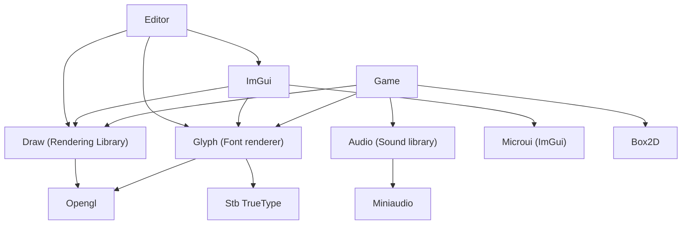

+++
date = '2026-11-08T18:14:11+05:45'
draft = false
title = 'Write a Game Engine'
slug = 'write-a-game-engine'
description = 'Starting a from-scratch game engine series in Odin: goals, architecture, and the libraries we will use.'
tags = ['odin', 'game-engine', 'opengl']
categories = ['Game Engine']
series = ['Creating a Game Engine']
weight = 1
+++

In this blog series we will create a game engine from "scratch". This is indented for tutorial purpose but you could use it for a real project.

<!--more-->

## What defines a game engine?

A game engine is something you use to make games. It is mostly a collection of libraries.  There are no strict requirements for a software to have to be considered a game engine but following are the primary features it is expected to have.

1. Renderer : functions to render textures, primitive shapes, fonts etc.
2. Physics Engine: tools and functions to simulate physics on entities.
3. Level editor: Create and edit levels with functionalities like undo redo and save on disk.
4. Entity management : Create ways to store and simulate entities etc.
5. Audio : support loading and playing audios in relation to game events.
6. Game logic : support accepting game logic to manipulate and handle game events provided by users.

## Architecture

This is a high level architecture of the game engine that we will try to implement.

Lets go thru the libraries we will be using from the odin's vendor one by one.

1. **Box2D**: Box2d is a physics engine which does 2d world simulation and provides many APIs and callbacks of game events. We will heavily rely on Box2D for simulation, which means we won't be writing much of physics code.

2. **GLFW** : GLFW is used for window management it is easy to integrate with OpenGL and spares us from using the Win32 api.

3. **OpenGL** : OpenGL is a set of APIs that we can extract and use to manipulate graphics. We will be using OpenGL because it's widely available and fairly easy to implement. There is a great blog [learnopengl.com](https://learnopengl.com) if you aren't familiar with it and wanna learn it.

4. **stb_truetype** : stb truetype is a single file header library to parse and render truetype fonts. We will  use this for rendering fonts.

5. **miniaudio** : miniaudio is similar single file header library like stb_truetype to parse different mp3 files and also play the sounds.

6. **Microui**: Microui is a minimal immediate mode graphics library, we will be using this for all our interfaces for designing levels.

7. Odin's core library: Other than these vendor library we will be depending alot on odin's core library such as queues, log, linalg etc.
